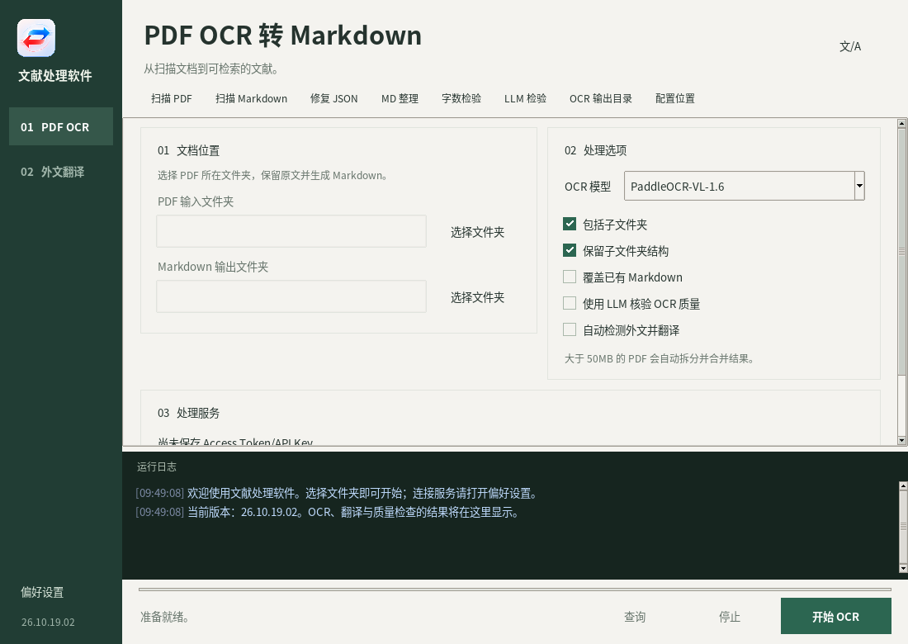
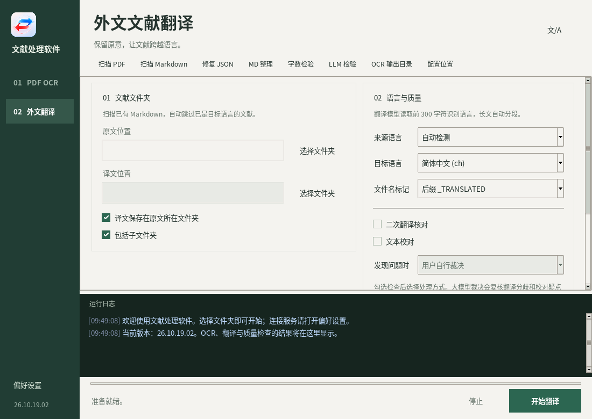
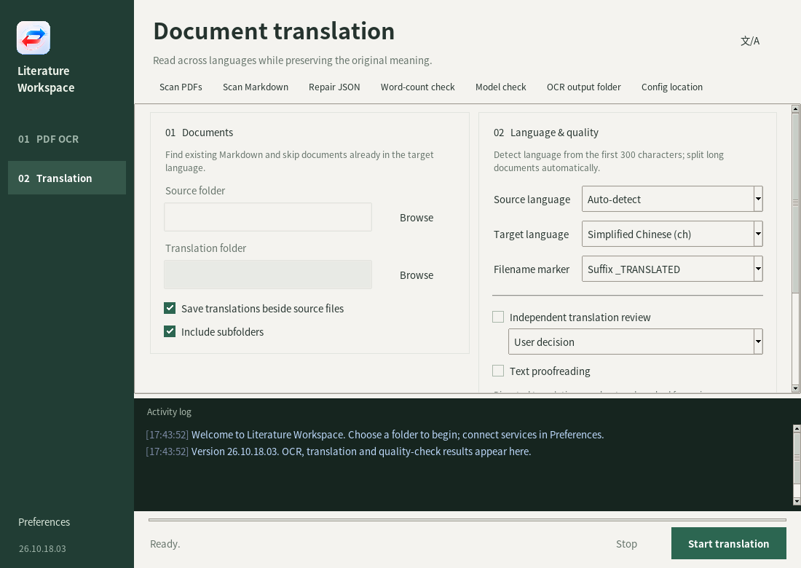
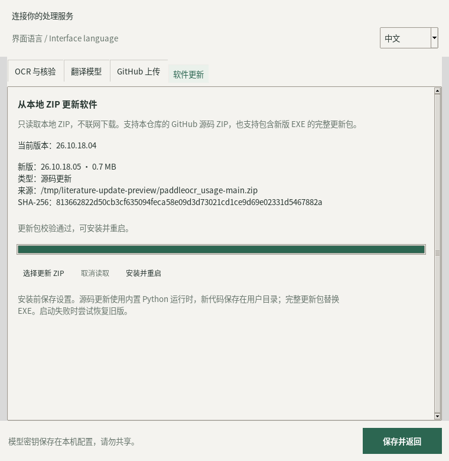
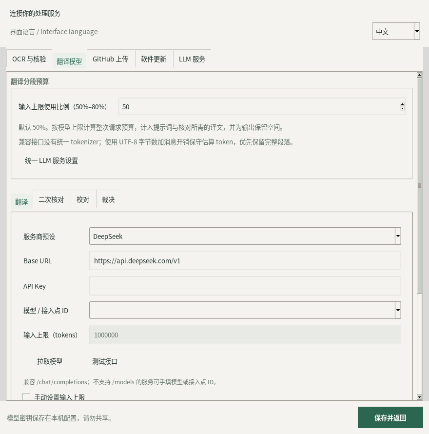
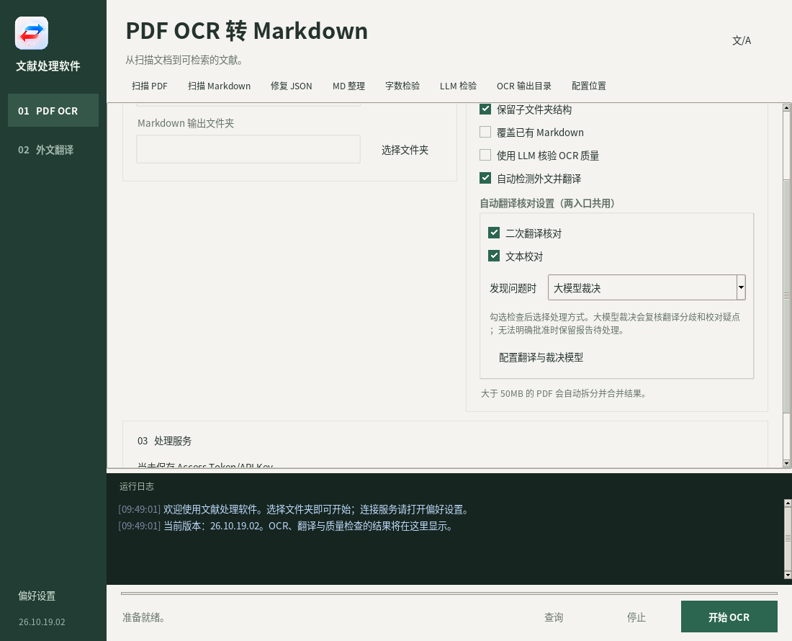
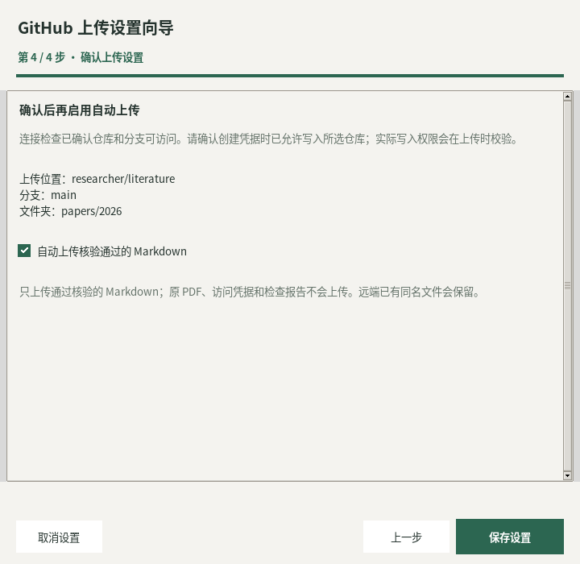

# Literature Processing Software · 文献处理软件

This is an executable (and the original `.py` script for Linux and macOS users!) that uses PaddleOCR to convert scanned, non-searchable **Chinese** PDFs into searchable `.md` and `.json` files (`.md` is much easier for AI to read and understand than PDF!).

For more information, please read the README. Terms And Condition please read below.

这是一个可执行程序（还附带了供 Linux 和 macOS 用户使用的原始 `.py` 脚本！），通过 PaddleOCR 将扫描版、不可检索的**中文** PDF 转换为可检索的 `.md` 和 `.json` 文件（对 AI 来说，`.md` 可比 PDF 好读、好理解多了！）。

更多信息请参阅 README，使用条件请见下方条款。


**Version: 26.10.18.04**
**版本：26.10.18.04**

**Primary platform: Windows 10/11**  
**主要适用平台：Windows 10/11**

**Default model: `PaddleOCR-VL-1.6`**  
**默认模型：`PaddleOCR-VL-1.6`**

A Windows desktop tool for batch-converting PDF files to Markdown through the PaddleOCR online asynchronous API.  
本工具是一个 Windows 桌面程序，用于通过 PaddleOCR 在线异步 API 批量将 PDF 转换为 Markdown。

Version `26.10.18.04` provides two entries: **PDF OCR 转 MD功能** and **外文文献翻译功能**. The OCR features described below are retained, with optional translation, quality checks, and reviewed-file GitHub uploads.  
`26.10.18.04` 提供 **PDF OCR 转 MD功能** 和 **外文文献翻译功能** 两个入口，保留下方介绍的 OCR 功能，并增加可选翻译、质量检查和核验后 GitHub 上传。

It supports page-level progress reporting, Markdown word-count quality checks with automatic resubmission, manual status checks, automatic retry when the submission queue is full, automatic splitting of PDFs larger than 50 MB, JSON/JSONL recovery, and one-click EXE packaging.  
本工具支持页级进度显示、Markdown 字数质量检测与自动重新提交、手动查询任务状态、提交队列已满时自动重试、自动拆分超过 50MB 的 PDF、JSON/JSONL 修复，以及一键打包 EXE。

---

## Contents / 目录

1. [Features   功能概述](#features)
2. [Requirements   运行要求](#requirements)
3. [Package Contents   文件组成](#package-contents)
4. [Quick Start   快速开始](#quick-start)
5. [Interface and Preferences   界面与偏好设置](#interface)
6. [PDF OCR to Markdown   PDF OCR 转 MD](#pdf-ocr)
7. [Foreign-Language Literature Translation   外文文献翻译](#translation)
8. [Output Files and Task Recovery   输出文件与任务恢复](#output-files)
9. [Upload Reviewed Files to GitHub   核验后上传 GitHub](#github-upload)
10. [Build and Distribute the Windows EXE   构建与分发 Windows EXE](#build-exe)
11. [Troubleshooting   常见问题](#troubleshooting)
12. [Privacy and Security   隐私与安全](#privacy)
13. [Known Limitations   已知限制](#limitations)
14. [Development and Tests   开发与测试](#development)
15. [Version 26.10.18.04 Changes   26.10.18.04 更新说明](#release-notes)
16. [License   许可证](#license)

---

<a id="features"></a>

## 1. Features   功能概述

- Batch-process all PDF files in a selected folder.  
  批量处理所选文件夹中的全部 PDF。

- Optionally scan subfolders recursively.  
  可选择递归扫描子文件夹。

- Preserve the original subfolder structure in the output directory.  
  可在输出目录中保留原始子文件夹结构。

- Convert each PDF to a same-name Markdown file.  
  为每个 PDF 生成同名 Markdown 文件。

- Save the PaddleOCR response as JSON for troubleshooting and recovery.  
  保存 PaddleOCR 返回的 JSON，便于排错和恢复。

- Display overall file progress.  
  显示全部文件的总体进度。

- Display the current PDF page progress.  
  显示当前 PDF 的页数进度。

- Display the current task status.  
  显示当前任务状态。

- Display detailed runtime logs.  
  显示详细运行日志。

- Manually query the current OCR job without waiting for the next automatic polling cycle.  
  可手动查询当前 OCR 任务，无需等待下一次自动轮询。

- Validate the saved PaddleOCR Access Token/API Key.  
  可检测已保存的 PaddleOCR Access Token/API Key 是否有效。

- Save the Access Token locally so it does not need to be entered every time.  
  在本地保存 Access Token，无需每次重新输入。

- Verify the generated Markdown contains at least 150 words/CJK characters per page; otherwise delete the result and job cache and resubmit up to three total attempts.  
  生成 Markdown 后检查平均每页是否至少包含 150 个词/汉字；不足时删除结果及 jobId 缓存并重新提交，最多共尝试三次。

- Automatically retry when PaddleOCR reports that the submission queue is full.  
  当 PaddleOCR 提示提交队列已满时自动重试。

- Automatically split PDFs larger than 50 MB, OCR each part, and merge the results.  
  自动拆分超过 50MB 的 PDF，逐段 OCR 后再合并结果。

- Repair existing `.json`, `.jsonl`, or `.raw.json` files into directly usable `.md` files.  
  可将已有的 `.json`、`.jsonl` 或 `.raw.json` 修复为可直接使用的 `.md` 文件。

- Safely request cancellation with a confirmation dialog.  
  通过二次确认对话框安全停止转换。

- Build a standalone Windows EXE with the included packaging script.
  可通过配套打包脚本生成独立的 Windows EXE。

- Switch between Chinese and English immediately, and restore the selected interface language on the next launch.  
  即时切换汉英界面，并在下次启动时恢复所选界面语言。

- Keep runtime logs visible in small windows, with scrollable settings and a draggable divider.
  小窗口下日志独立可见，设置区可以滚动，并可拖动分隔条调整高度。

- Translate existing foreign-language Markdown files, or optionally translate newly generated OCR results.
  翻译已有外文 Markdown，或按需在 OCR 完成后自动进行翻译。

- Configure OpenAI-compatible models for translation, independent secondary review, proofreading, and user/model arbitration.
  分别配置 OpenAI-compatible 模型进行翻译、独立二次核对、文本校对及人工/模型裁决。

- Select translation output folders and filename markers, then optionally upload reviewed Markdown to a chosen GitHub repository.
  可选择译文目录和文件名标记，并按需将核验通过的 Markdown 上传至指定 GitHub 仓库。

---

<a id="requirements"></a>

## 2. Requirements   运行要求

Windows 10 or Windows 11 is recommended.  
建议使用 Windows 10 或 Windows 11。

Python 3.9 or later is required.  
需要安装 Python 3.9 或更高版本。

Internet access is required.  
必须能够正常访问互联网。

The PDF OCR workflow requires a valid PaddleOCR official API Access Token/API Key. Translation-only use requires the chosen LLM provider's API access instead.  
PDF OCR 流程需要有效的 PaddleOCR 官方 API Access Token/API Key。仅使用翻译功能时，需要配置所选大模型服务的 API，而不需要 PaddleOCR Token。

The launcher automatically creates a local virtual environment.  
启动脚本会自动创建本地虚拟环境。

The launcher automatically installs the following packages.  
启动脚本会自动安装以下依赖。

```text
requests
pypdf
```

---

<a id="package-contents"></a>

## 3. Package Contents   文件组成

The package normally contains the following current-version files.  
安装包通常包含以下当前版本文件。

All platforms require these fourteen Python modules in the same folder: `paddleocr_pdf_to_md_gui.py`, `literature_processing.py`, `literature_ui.py`, `workspace_ui.py`, `ui_i18n.py`, `ui_translations.py`, `responsive_ui.py`, `github_ui.py`, `model_budget.py`, `app_launcher.py`, `app_updater.py`, `source_bootstrap.py`, `update_ui.py`, and `make_update_package.py`. Keep `update_helper.ps1` alongside them.  
所有平台均须将十四个 Python 模块放在同一文件夹中：`paddleocr_pdf_to_md_gui.py`、`literature_processing.py`、`literature_ui.py`、`workspace_ui.py`、`ui_i18n.py`、`ui_translations.py`、`responsive_ui.py`、`github_ui.py`、`model_budget.py`、`app_launcher.py`、`app_updater.py`、`source_bootstrap.py`、`update_ui.py` 和 `make_update_package.py`，并保留 `update_helper.ps1`。

```text
paddleocr_pdf_to_md_gui.py
literature_processing.py
literature_ui.py
workspace_ui.py
ui_i18n.py
ui_translations.py
responsive_ui.py
github_ui.py
model_budget.py
app_launcher.py
app_updater.py
source_bootstrap.py
update_ui.py
make_update_package.py
update_helper.ps1
start_paddleocr_pdf_to_md_SAFE.bat
build_paddleocr_pdf_to_md_EXE.bat
README.md
app_icon.ico
app_icon.png
version_info_26.10.18.04.txt
requirements.txt
使用说明.txt
tests/
```

Old version snapshots such as `paddleocr_pdf_to_md_gui_26.7.12.02.py` and `README_26.7.12.01.txt` are no longer part of the current package.  
`paddleocr_pdf_to_md_gui_26.7.12.02.py`、`README_26.7.12.01.txt` 等旧版本快照不再属于当前发布包。

The ZIP release may contain the same current-version files.  
ZIP 发布包通常也包含上述当前版本文件。

---

<a id="quick-start"></a>

## 4. Quick Start   快速开始

### Option A: Run with the BAT Launcher  方式一：通过 BAT 启动

Keep the source modules, launcher, dependency list, and icons together. Do not copy only the main Python file.  
请将源码模块、启动器、依赖清单及图标放在同一文件夹中，不要只复制主 Python 文件。

```text
paddleocr_pdf_to_md_gui.py
literature_processing.py
literature_ui.py
workspace_ui.py
ui_i18n.py
ui_translations.py
responsive_ui.py
github_ui.py
model_budget.py
app_launcher.py
app_updater.py
source_bootstrap.py
update_ui.py
make_update_package.py
update_helper.ps1
start_paddleocr_pdf_to_md_SAFE.bat
requirements.txt
app_icon.ico
app_icon.png
```

Double-click the following file.  
双击以下文件。

```text
start_paddleocr_pdf_to_md_SAFE.bat
```

On first launch, the script locates Python.  
首次运行时，脚本会查找 Python。

It then creates a `.venv` virtual environment.  
随后会创建 `.venv` 虚拟环境。

It installs or updates `requests` and `pypdf`.  
接着会安装或更新 `requests` 与 `pypdf`。

Finally, it starts the graphical interface. Choose one of the two workflow entries. Translation-only users are not prompted for an OCR token at startup.  
最后会启动图形化界面，选择两个功能入口之一即可；仅翻译的用户不会在启动时被要求填写 OCR Token。

### Option B: Run the Python File Directly   方式二：直接运行 Python 文件

Install the dependencies first.  
请先安装依赖。

```bat
python -m pip install --upgrade requests pypdf
```

Then run the application.  
随后运行程序。

```bat
python paddleocr_pdf_to_md_gui.py
```


### Option C: Run on Linux  方式三：在 Linux 上运行

The `.bat` launcher and packaged `.exe` are Windows-only.  
`.bat` 启动器和打包后的 `.exe` 仅适用于 Windows。

Linux users should run the `.py` file directly.  
Linux 用户应当直接运行 `.py` 文件。

Open a terminal in the folder containing `paddleocr_pdf_to_md_gui.py`.  
在包含 `paddleocr_pdf_to_md_gui.py` 的文件夹中打开终端。

Create a virtual environment.  
创建虚拟环境。

```bash
python3 -m venv .venv
```

Activate the virtual environment.  
激活虚拟环境。

```bash
source .venv/bin/activate
```

Upgrade pip and install the required packages.  
升级 pip 并安装所需依赖。

```bash
python3 -m pip install --upgrade pip requests pypdf
```

Start the graphical application.  
启动图形化程序。

```bash
python3 paddleocr_pdf_to_md_gui.py
```

The graphical interface requires Python Tkinter support.  
图形化界面需要 Python 的 Tkinter 支持。

If Linux reports `ModuleNotFoundError: No module named 'tkinter'`, install the Tkinter package supplied by your distribution.  
如果 Linux 提示 `ModuleNotFoundError: No module named 'tkinter'`，请安装当前发行版提供的 Tkinter 软件包。

On Debian or Ubuntu, you can usually run the following command.  
在 Debian 或 Ubuntu 上，通常可以运行以下命令。

```bash
sudo apt update
sudo apt install python3-tk
```

On Fedora, you can usually run the following command.  
在 Fedora 上，通常可以运行以下命令。

```bash
sudo dnf install python3-tkinter
```

On Arch Linux, you can usually run the following command.  
在 Arch Linux 上，通常可以运行以下命令。

```bash
sudo pacman -S tk
```

After installing Tkinter, restart the application.  
安装 Tkinter 后，请重新启动程序。

### Option D: Run on macOS   方式四：在 macOS 上运行

The `.bat` launcher and packaged Windows `.exe` cannot run on macOS.  
`.bat` 启动器和 Windows `.exe` 无法在 macOS 上运行。

macOS users should run the `.py` file directly with Python 3.  
macOS 用户应当使用 Python 3 直接运行 `.py` 文件。

Open Terminal in the folder containing `paddleocr_pdf_to_md_gui.py`.  
在包含 `paddleocr_pdf_to_md_gui.py` 的文件夹中打开“终端”。

Create a virtual environment.  
创建虚拟环境。

```bash
python3 -m venv .venv
```

Activate the virtual environment.  
激活虚拟环境。

```bash
source .venv/bin/activate
```

Upgrade pip and install the required packages.  
升级 pip 并安装所需依赖。

```bash
python3 -m pip install --upgrade pip requests pypdf
```

Start the graphical application.  
启动图形化程序。

```bash
python3 paddleocr_pdf_to_md_gui.py
```

The graphical interface requires a Python installation with Tkinter support.  
图形化界面需要所使用的 Python 支持 Tkinter。

If `import tkinter` fails, install a Python distribution that includes Tk support, such as the current installer from Python.org, or add compatible Tcl/Tk support to your existing Python installation.  
如果 `import tkinter` 失败，请安装包含 Tk 支持的 Python 发行版，例如 Python.org 提供的当前安装程序，或为现有 Python 安装兼容的 Tcl/Tk 支持。

You can test Tkinter with the following command.  
可以使用以下命令测试 Tkinter。

```bash
python3 -m tkinter
```

A small test window should appear if Tkinter is available.  
如果 Tkinter 可用，屏幕上应当弹出一个测试窗口。

The Windows EXE packaging BAT does not create a native Linux or macOS application.  
Windows EXE 打包 BAT 不会生成原生 Linux 或 macOS 应用程序。

Linux and macOS users should keep the `.py` file and run it through the virtual environment described above.  
Linux 与 macOS 用户应保留 `.py` 文件，并通过上述虚拟环境运行。

---

<a id="interface"></a>

## 5. Interface and Preferences   界面与偏好设置

### Navigation and Small Windows   导航与小窗口

The minimum window size is 540×420. Navigation moves from a sidebar to a compact top bar in narrow windows. Task options scroll independently, with side-by-side groups in wide windows. Start/stop controls and runtime logs remain visible; drag the divider to adjust log height. Service credentials and model configuration live in the separate Preferences window.  
最小窗口为 540×420。宽窗口使用侧栏导航和并排选项，窄窗口切换为紧凑顶部导航；任务选项可独立滚动，开始/停止按钮和运行日志固定可见，拖动分隔条可调整日志高度。服务凭据与模型配置集中在独立的偏好设置窗口。

The workspace follows [Emil Kowalski’s design-engineering guidance](https://github.com/emilkowalski/skills/tree/main/skills/emil-design-eng): consistent control states, clear task hierarchy, and instant keyboard navigation.
界面参考 [Emil Kowalski 的设计工程技能](https://github.com/emilkowalski/skills/tree/main/skills/emil-design-eng)，统一控件状态与任务层级，键盘切换直接响应。





### Adaptive Labels and Fields   标签与输入区域自适应

Field captions use their natural text width. Inputs share the available space, and the form moves a caption above its input when the caption or selected value needs more room. Descriptions and model summaries wrap with the window. Compact status messages use up to two lines; their complete value remains available on hover and in the workflow log where applicable.  
表单标签按实际文字宽度显示，输入框使用剩余空间；标签或已选内容需要更多空间时，会自动改为上方标签、下方整行输入。说明文字和模型摘要随窗口换行。底部状态最多显示两行，完整内容可通过悬停查看，相关处理信息也会记录在日志中。

Visible toolbar buttons provide PDF/Markdown scanning, JSON repair, manual word-count/LLM checks, the OCR output folder and configuration location; they wrap automatically in narrow windows. Cards and controls share the workspace background.  
扫描 PDF/Markdown、修复 JSON、手动字数/LLM 检验、打开 OCR 输出目录和显示配置位置均直接显示为工具按钮，窄窗口自动换行。卡片与控件统一使用工作区底色。

### Chinese / English Interface   汉英界面切换

Click the upper-right **文/A** icon to switch immediately between Chinese and English, or use **Preferences → Interface language → English / 中文**. The choice is saved for the next launch. Menus, settings, language/provider choices, prompts, progress and application messages are localized. Paths, model IDs, credentials, document contents and translation source/target settings retain their values.  
点击主界面右上角的 **文/A** 图标即可即时切换中文和英文，也可在**偏好设置 → 界面语言 → English / 中文**中选择；下次启动会恢复选择。菜单、设置、语言与服务商选项、提示、进度和程序消息均支持中英文。文件路径、模型 ID、凭据、文献内容及翻译来源/目标语言保持原值。



### Local ZIP Updates   本地 ZIP 更新

Version `26.10.18.04` introduces **Preferences → Updates**. Select **Choose update ZIP**, review the detected version, type, source path and SHA-256, then choose **Install and restart**. Only local files are read; the updater never checks GitHub, downloads code or installs dependencies online. Wait for OCR, translation and checks to finish before installation.  
`26.10.18.04` 增加 **偏好设置 → 软件更新**。点击 **选择更新 ZIP**，确认识别出的版本、类型、路径和 SHA-256，再点击 **安装并重启**。更新流程只读取本地文件，不自动检查 GitHub、不下载代码、不联网安装依赖；安装前须等待 OCR、翻译及检查任务结束。

**Ordinary GitHub source ZIP:** download this repository's source ZIP yourself and import it without unpacking or repacking. A single enclosing folder such as `paddleocr_usage-main/` is supported. The updater reads the literal `APP_VERSION`, checks syntax and dependencies, and installs runtime source files in `%LOCALAPPDATA%\PaddleOCR\updates`. On restart, the stable EXE launcher executes the updated application modules through its bundled Python runtime. Importing and validating the archive does not execute its code.  
**GitHub 原始源码 ZIP：**自行下载本仓库的源码 ZIP，直接导入即可，无须解压或重新打包；支持 `paddleocr_usage-main/` 等单层外目录。程序读取源码中的 `APP_VERSION`，检查语法与依赖，并将运行所需源码安装到 `%LOCALAPPDATA%\PaddleOCR\updates`。重启后由固定 EXE 启动器使用内置 Python 运行时加载新版模块。读取和校验 ZIP 时不会执行其中的代码。

The source version must be newer than the running version. The dependency list must match the bundled runtime, and statically imported external modules must be available. Changes to Python, the protected launcher, or unbundled dependencies require a full program update. Dynamic imports and startup behavior are verified by startup acknowledgement rather than guaranteed by static checks. The program records file hashes and checks them again before activation and on startup.  
源码版本须高于当前运行版本，依赖清单须与内置运行时一致，静态导入的外部模块也须已具备。更换 Python、修改受保护启动器或增加未打包依赖时，需要完整程序更新包；静态检查不能保证所有动态导入和启动行为，仍会通过启动确认机制验证。安装前及每次启动时会再次检查已安装源码的文件哈希。

**Full program ZIP:** maintainers run `build_paddleocr_pdf_to_md_EXE.bat`, which now builds the stable launcher and generates both the normal EXE and `PaddleOCR_Update_26.10.18.04.zip`. This ZIP contains the new EXE, `update.json` and checksum. It can replace the running program after it exits, while retaining a backup. A publisher can also run `python make_update_package.py <compiled.exe>` to generate it.  
**完整程序 ZIP：**维护者运行 `build_paddleocr_pdf_to_md_EXE.bat`，现在会编译固定启动器，同时生成普通 EXE 及 `PaddleOCR_Update_26.10.18.04.zip`。ZIP 内包含新版 EXE、`update.json` 和校验文件；当前程序退出后可替换 EXE，并保留旧版备份。也可执行 `python make_update_package.py <已编译的.exe>` 单独生成完整更新包。

Installation saves the current settings and restarts through a separate Windows helper. The current app exits only after the helper acknowledges startup; if the helper cannot start, the app stays open. The new GUI must acknowledge the expected version within 120 seconds; failed startup triggers a recovery attempt. Source updates restore the previous activation record; full updates restore the old EXE. Unreadable directories, active tasks and invalid packages block installation. Updates do not rewrite literature; configuration stays at its existing location, and unknown future configuration fields survive fallback. Recovery results and logs are available on the Updates page.  
安装时保存当前设置，并通过独立 Windows 更新助手重启；只有收到助手就绪确认后主程序才会退出，助手无法启动时会保持当前程序运行。新 GUI 须在 120 秒内确认预期版本，启动失败时会尝试恢复：源码更新恢复原激活记录，完整更新恢复旧 EXE。目录不可写、任务未结束或更新包无效时不会安装。更新助手不改写文献，配置沿用原位置，退回内置版本时也保留新版配置中的未知字段。可在软件更新页查看恢复结果和日志位置。

Older EXEs do not contain this launcher: manually replace them once with the first update-enabled EXE. After a source update, the GUI reports the source version while the EXE filename and Windows file properties retain the launcher's build version. Copying only that EXE to another computer carries the built-in version, not source updates stored in the previous user's profile. Import only packages from a trusted publisher: SHA-256 detects changes but is not a publisher signature. Automatic installation is for the Windows EXE; source mode and other platforms can preview packages.  
旧 EXE 没有此启动机制，首次须手动换成支持更新的新 EXE。源码更新后，界面显示源码版本，磁盘 EXE 文件名及 Windows 文件属性仍是启动器的构建版本；仅将该 EXE 拷到另一台电脑，会携带其内置版本，不会携带原用户目录里的后续源码更新。只导入可信发布者提供的包，SHA-256 用于检查完整性，不是发布者数字签名。自动安装仅用于 Windows EXE，源码运行与其他平台可预览更新包。



---

<a id="pdf-ocr"></a>

## 6. PDF OCR to Markdown   PDF OCR 转 MD

### Access Token Setup   Access Token 设置

Open **Preferences → OCR & checks** in the application. These token settings apply to the PDF OCR workflow.  
打开程序中的 **偏好设置 → OCR 与核验**；本节 Token 设置用于 PDF OCR 流程。

Click **Set / update Access Token**.  
点击“输入/更新 Access Token”。

Paste the PaddleOCR official API Access Token/API Key.  
粘贴 PaddleOCR 官方 API Access Token/API Key。

Click **Validate API Key** to verify it.  
点击“检测 API Key 是否有效”进行验证。

The token and application settings are stored at the following location.  
Token 与程序设置保存在以下位置。

```text
%APPDATA%\PaddleOCRBatchGUI\config.json
```

The configuration file is stored as plain text.  
该配置文件以明文形式保存。

Do not share it, upload it publicly, or include it in a public repository.  
请勿将其发送给他人、公开上传或提交到公开代码仓库。

### Available OCR Models   可选 OCR 模型

The application currently provides the following models.  
程序当前提供以下模型。

This list is current for version `26.10.18.04`.  
以下列表对应 `26.10.18.04` 当前版本。

```text
PaddleOCR-VL-1.6
PaddleOCR-VL-1.5
PaddleOCR-VL
PP-StructureV3
```

The default model is `PaddleOCR-VL-1.6`.  
默认模型为 `PaddleOCR-VL-1.6`。

Version 26.10.18.04 retains the post-OCR word-count quality check and automatic resubmission, with `PaddleOCR-VL-1.6` as the default OCR model.
26.10.18.04 版本保留 OCR 后字数质量检测与自动重新提交功能，默认 OCR 模型继续使用 `PaddleOCR-VL-1.6`。

Actual availability depends on the PaddleOCR account and server-side API configuration.  
模型是否实际可用，取决于 PaddleOCR 账户权限和服务端 API 配置。

### Basic Conversion Workflow   基本转换流程

Select **PDF OCR**.  
选择 **PDF OCR 转 MD功能** 入口。

Select the PDF input folder.  
选择 PDF 输入文件夹。

Select the Markdown output folder.  
选择 Markdown 输出文件夹。

Choose a model.  
选择模型。

Choose whether to scan subfolders recursively.  
选择是否递归扫描子文件夹。

Choose whether to preserve the original subfolder structure.  
选择是否保留原始子文件夹结构。

Choose whether to overwrite existing output files.  
选择是否覆盖已有输出文件。

Optionally enable **Detect foreign languages and translate** after configuring [the translation entry](#translation). Leave it off for OCR alone. Only newly completed OCR files enter this follow-up; existing outputs skipped by OCR can be processed through the translation entry.  
Enabling it expands **Translation checks (shared by both entries)** on the OCR page. Enable independent review and/or proofreading, choose **Model decision** under **When issues are found**, then use **Configure translation and decision models** for the relevant services. Configuring a decision model alone does not enable checks or select that mode. Set these options before starting; changes during a batch apply to the next run.  
按需勾选 **自动检测外文并翻译**，并先配置[翻译入口](#translation)（第 7 节）；不勾选时仅进行 OCR。只有本次新完成的 OCR 文件会进入后续翻译；被 OCR 跳过的已有输出可通过翻译入口处理。 勾选后，OCR 页会展开 **自动翻译核对设置（两入口共用）**：可直接启用二次核对／文本校对，并在 **发现问题时** 选择 **大模型裁决**。点击 **配置翻译与裁决模型** 填写相应服务。只填写裁决模型不会自动启用检查或切换处理方式；应在开始任务前设置，运行中修改用于下次任务。

Click **Start OCR**.  
点击“开始 OCR”。

Confirm the task summary.  
确认任务摘要。

The application submits each PDF as an asynchronous PaddleOCR job.  
程序会将每个 PDF 作为异步 PaddleOCR 任务提交。

It stores the returned `jobId`.  
程序会保存接口返回的 `jobId`。

It then polls the server until the task is complete.  
程序会持续查询服务器，直至任务完成。

### Automatic Large-PDF Splitting   大 PDF 自动拆分

The PaddleOCR local upload path has a 50 MB file-size limit.  
PaddleOCR 本地上传路径存在 50MB 的文件大小限制。

When the application detects a PDF larger than 50 MB, it reads the PDF by page.  
检测到超过 50MB 的 PDF 后，程序会按页读取文件。

It splits the PDF into ordered parts of approximately 45 MB.  
程序会按照原页序拆分为约 45MB 的分段。

It verifies each part before submission.  
提交前会校验每个分段。

It submits each part separately.  
每个分段会分别提交。

It maps the progress of each part back to the original PDF page range.  
程序会将各分段进度映射回原 PDF 的页码范围。

It merges all Markdown output in the original page order.  
程序会按原始页序合并全部 Markdown。

It creates one final `.md` file and one final `.json` file.  
最终只生成一个 `.md` 文件和一个 `.json` 文件。

If a single isolated page is still larger than the safe split target, the application cannot split it further.  
如果某一页单独拆出后仍超过安全拆分目标，程序将无法继续拆分。

The application will report the relevant page number.  
程序会明确提示对应页码。

Encrypted or damaged PDFs may also fail to split.  
加密或损坏的 PDF 也可能无法拆分。

### Markdown Word-Count Quality Check   Markdown 字数质量检测

After each OCR job generates Markdown, the application counts its text before accepting the result. Chinese, Japanese, and Korean unified ideographs are counted one character at a time; non-CJK text is counted by word. Markdown punctuation and formatting symbols are not counted as words.  
每次 OCR 任务生成 Markdown 后，程序都会先统计文本数量，再决定是否接受该结果。中日韩统一表意文字按单个汉字计数，非 CJK 文本按单词计数；Markdown 标点和格式符号不计入字数。

The result passes when it contains at least **150 words/CJK characters per PDF page**. For example, a two-page PDF must contain at least 300 counted units. The page count is read from the PaddleOCR job result when available and otherwise from the local PDF.  
当结果达到**平均每页至少 150 个词/汉字**时即通过。例如，两页 PDF 至少需要 300 个计数单位。程序优先读取 PaddleOCR 任务返回的页数，若返回结果没有页数，则读取本地 PDF。

If the result is below the threshold on the first or second attempt, the application deletes all artifacts from that attempt before submitting a completely new OCR job:  
如果第一次或第二次结果低于阈值，程序会删除该次尝试产生的全部文件，然后重新提交一个全新的 OCR 任务：

```text
example.md
example.json (when present)
example.raw.json
_paddleocr_jobs\<document>.job.json
```

Deleting the job-cache JSON prevents the previous `jobId` from being reused. Each quality attempt receives a distinct batch ID. There are at most **three OCR attempts in total**; this is separate from queue-full submission retries.  
删除 Job 缓存 JSON 可以防止程序复用上一次的 `jobId`。每次质量重试都会使用不同的批次 ID。每个文档**最多共执行三次 OCR**；此流程与“队列已满”时的提交重试相互独立。

If the third OCR result is still below the threshold, the application keeps that final Markdown and JSON for inspection instead of entering an infinite retry loop. It records the count, page count, threshold, attempt number, and warning in the raw JSON, and appends the following warning to the runtime log and final batch summary:  
如果第三次 OCR 结果仍低于阈值，程序会保留最后一次 Markdown 和 JSON 供人工检查，而不会无限重试。Raw JSON 会记录计数、页数、阈值、尝试次数和警告，并在运行日志与最终批处理摘要中追加以下警告：

```text
请核验原件字数，PaddleOCR返回结果可能存在问题。
```

For PDFs larger than 50 MB, the check is applied to every automatically split part using that part's page count. A warning from any part is propagated to the final batch summary.  
对于超过 50MB 并被自动拆分的 PDF，程序会按照每个分段自身的页数分别检查字数；任一分段产生警告时，最终批处理摘要也会显示该警告。

### Optional OpenAI-Compatible LLM Review   可选 LLM 核验

Version `26.10.18.04` can optionally send each generated Markdown file to an OpenAI-compatible Chat Completions API (for example DeepSeek). Each chunk's raw LLM answer is immediately shown in the runtime log. A fresh OCR job is submitted only when the answer confirms missing pages or a severe logic-breaking error; ordinary OCR, layout, table, formula, ordering, or duplication defects do not trigger reconversion. Before resubmission, the app verifies deletion of the current `.md`, result JSON, review report, and jobId cache and logs the deleted paths. An LLM request failure is logged without deleting a successful OCR result.

`26.10.18.04` 可选接入 OpenAI-compatible Chat Completions API（例如 DeepSeek），并在运行日志中逐段即时显示 LLM 原始回答。只有确认缺页、少页、漏页或足以破坏原意的严重逻辑错误时，才会重新转换；普通 OCR、排版、表格、公式、顺序或重复问题不触发重转。重新提交前，程序会核实删除本次 `.md`、结果 JSON、核验报告和 jobId 缓存，并在日志列出已删除路径；LLM 请求失败只记录警告，不删除已成功生成的 OCR 结果。

1. In the PDF OCR page, enable **Check OCR quality with a model**.
2. Open **Preferences → OCR & checks** and enter the provider Base URL (the default is `https://api.deepseek.com/v1`) and API Key.
3. Click **Fetch model list** to query the compatible `GET /models` endpoint, then select a model. A model ID can also be entered manually for providers that do not expose model discovery.
4. Start the normal batch conversion. Long Markdown is reviewed in 50,000-character chunks so the whole file is covered.

The review prompt reserves `has_problem=true` for confirmed missing-page failures and severe errors that make the document's logic invalid. Uncertain findings and ordinary OCR or formatting defects must return false. The model must return structured JSON with a boolean conclusion, severity, summary, issues, and short evidence.

1. 在 PDF OCR 页面勾选 **使用 LLM 核验 OCR 质量**。
2. 打开 **偏好设置 → OCR 与核验**，填写服务商 Base URL（默认 `https://api.deepseek.com/v1`）和 API Key。
3. 点击 **拉取模型列表**，程序会调用兼容的 `GET /models` 接口，然后选择模型；若服务商不支持模型发现，也可手工输入模型 ID。
4. 正常开始批处理。长 Markdown 会按每段 50,000 字符逐段核验，避免只检查文件开头。

The API Key is saved in the same user configuration as the PaddleOCR Token. Use a trusted personal computer and check the provider's data policy; document text is sent to the configured third-party LLM service.  
API Key 会与 PaddleOCR Token 一样保存在当前用户配置文件中。请只在可信的个人电脑上使用，并确认服务商的数据处理政策；文档正文会发送给所配置的第三方 LLM 服务。

#### Test LLM API Connectivity   测试 LLM API 连通性

After entering the Base URL, API Key, and model, click **Test LLM API**. The application sends a small `chat/completions` request asking the selected model to reply `OK`. The request deliberately does not impose a tiny `max_tokens` limit because reasoning models may consume that allowance before producing visible content. A successful result therefore verifies the endpoint, authentication, selected model access, and actual generation path—not merely that `GET /models` is reachable. The test runs in the background and shows the model reply; it does not send document content.

填写 Base URL、API Key 和模型后，点击 **测试LLM API**。程序会向 `chat/completions` 发送一个仅要求所选模型回复 `OK` 的小请求。测试请求不再设置过小的 `max_tokens`，因为推理模型可能在生成可见正文前就耗尽该额度。因此测试成功能够同时验证接口地址、鉴权、模型访问权限和实际生成链路，而不只是验证 `GET /models` 是否可访问。测试在后台运行，会显示模型回复，且不会发送文档内容。

### Progress and Manual Query   进度与手动查询

The application provides a file-progress indicator.  
程序提供文件总进度条。

This shows the number of completed PDFs out of all discovered PDFs.  
该进度条显示已完成 PDF 数量与全部 PDF 数量。

The application also provides a page-progress indicator.  
程序还提供当前页数进度条。

This shows the extracted pages out of the current PDF’s total pages.  
该进度条显示当前 PDF 已解析页数与总页数。

Automatic status polling normally occurs every 3 seconds.  
程序通常每 3 秒自动查询一次任务状态。

Click **Query** to force an immediate status check.  
点击“查询”可立即查询任务状态。

This skips the current polling wait.  
该操作会跳过当前轮询等待。

It immediately queries the active `jobId`.  
程序会立即查询当前活动的 `jobId`。

It does not submit a duplicate job.  
该功能不会重复提交任务。

### Queue-Full Retry Behavior   队列已满时的自动重试

PaddleOCR may return the following message.  
PaddleOCR 可能返回以下提示。

```text
任务提交队列已满，请稍后重试
```

The application also recognizes the equivalent queue-full error code.  
程序也会识别对应的队列已满错误码。

The application waits 20 seconds before retrying.  
程序会等待 20 秒后重试。

It automatically resubmits the current document.  
程序会自动重新提交当前文档。

It attempts submission up to 3 times.  
程序最多尝试提交 3 次。

If all three attempts fail, the current PDF is skipped.  
如果三次尝试均失败，程序会跳过当前 PDF。

The batch then continues with the next file.  
随后继续处理下一个文件。

Rate-limit responses are also retried after a delay.  
遇到请求频率过高时，程序也会等待后重试。

### Stopping a Conversion   停止转换

Use the **Stop** button in the OCR entry to request cancellation.  
在 OCR 入口点击 **停止** 按钮，可以请求取消当前任务。

Clicking it opens a second confirmation dialog.  
点击该按钮后会弹出二次确认窗口。

After confirmation, the application stops submitting new files.  
确认后，程序不再提交新的文件。

It attempts to exit the current polling workflow safely.  
程序会尽量安全退出当前查询流程。

A job already submitted to the PaddleOCR server cannot be cancelled by this application.  
已经提交到 PaddleOCR 服务器的任务无法由本程序撤销。

Its saved `jobId` may be reused during the next run.  
其已保存的 `jobId` 可在下次运行时复用。

Stopping the application does not necessarily stop server-side processing.  
停止本程序并不一定会终止服务器端已经开始的 OCR。

### Manual Markdown Checks   手动检验已有 Markdown

Use the **Word-count check** toolbar button to select one or more existing `.md` files. The application reads the page count from a sibling `.raw.json`/`.json` or same-name PDF when available; otherwise it conservatively treats the document as one page. It reports the counted words/CJK characters and the required threshold without deleting files or resubmitting OCR.

Use the **Model check** toolbar button to review existing `.md` files with the configured OpenAI-compatible model. It runs in the background and writes a sibling `.llm-review.json`. Manual checks are diagnostic only: they never delete files or submit OCR jobs.

使用 主界面的 **字数检验** 按钮 可选择一个或多个已有 `.md`。程序优先从同名 `.raw.json`、`.json` 或 PDF 获取页数，均不存在时按一页计算；该操作只显示字数与阈值，不删除文件，也不重新提交 OCR。

使用 主界面的 **LLM 检验** 按钮 可通过已配置的 OpenAI-compatible 模型核验已有 `.md`。检验在后台运行，并写入同名 `.llm-review.json`。两种手动检验都仅供诊断，不会删除文件或提交 OCR 任务。

### Repair JSON to Markdown   将 JSON 修复为 Markdown

Use the **Repair JSON** toolbar button when OCR completed but no usable Markdown was produced.  
当 OCR 已完成但没有生成可用 Markdown 时，可以使用主界面的“修复 JSON”按钮。

Use it when you downloaded the API `jsonUrl` result.  
当你已经下载接口返回的 `jsonUrl` 结果时，也可以使用该功能。

Use it when you have a previous `.raw.json`.  
当你持有旧版程序生成的 `.raw.json` 时，也可以使用该功能。

Use it when you have PaddleOCR output in JSONL format.  
当你持有 PaddleOCR 返回的 JSONL 文件时，也可以使用该功能。

Supported input formats are listed below.  
支持的输入格式如下。

```text
.json
.jsonl
.raw.json
```

The repair tool parses ordinary JSON and line-delimited JSON.  
修复工具同时支持普通 JSON 和逐行 JSON。

It looks for structures such as the following.  
程序会尝试提取以下结构。

```text
layoutParsingResults[*].markdown.text
```

It writes a same-name `.md` file to the selected output folder.  
程序会在所选输出文件夹中生成同名 `.md` 文件。

If repair fails, a diagnostic file may be created.  
修复失败时，程序可能生成诊断文件。

```text
filename.repair_error.txt
```

---

<a id="translation"></a>

## 7. Foreign-Language Literature Translation   外文文献翻译

### Entry and Language Detection   入口与语言检测

Open **Document translation**, select a folder containing existing UTF-8 Markdown files, and optionally include subfolders. The default target language is Simplified Chinese; select another language or enter its name when needed. The source language can be detected automatically, selected from the common PaddleOCR language-code choices, or entered manually. Actual translation coverage depends on the selected LLM.  
打开 **外文文献翻译功能**，选择包含已有 UTF-8 Markdown 文件的文件夹，可选择递归扫描子文件夹。默认目标语言为简体中文，也可选择或手工输入其他语言。来源语言可自动检测、从常用 PaddleOCR 语言代码选项中选择，或手工输入；实际翻译范围取决于所选大模型。

For every file, the translation model reads the **first 300 characters** to identify its main language and determine whether it already matches the target. Matching files are skipped. A manually selected source language is used for translation without disabling this target-language check. Insufficient language evidence, such as an opening containing only links or code, produces an explicit error rather than an assumed detection result.  
程序对每份文件读取**前 300 字符**，由翻译模型识别主要语言并判断是否属于目标语言；已经是目标语言则跳过。手工来源语言用于翻译提示，不取消目标语言判断。若开头只有链接、代码等而无法可靠判断，会明确报错，不会假定识别成功。

The scanner excludes `TRANSLATED_*.md`, `*_TRANSLATED.md`, and a distinct output subtree inside the input folder. Click the **Scan Markdown** toolbar button to inspect the file count before starting.  
扫描会排除 `TRANSLATED_*.md`、`*_TRANSLATED.md`，以及输入文件夹内另设的输出子目录。开始前可点击主界面可见的 **扫描 Markdown** 工具按钮查看文件数量。

### OpenAI-Compatible Models   OpenAI-compatible 模型设置

Open **Preferences → Translation models**. Translation/language detection, secondary translation review, proofreading, and arbitration each have their own model settings tab. Enter the Base URL, API Key, and model or inference-endpoint ID. The presets are:  
打开 **偏好设置 → 翻译模型**，翻译/语言识别、二次翻译核对、文本校对和争议裁决分别提供模型设置标签页。填写 Base URL、API Key、模型或推理接入点 ID。提供以下预设：

| Provider 服务商 | Base URL |
| --- | --- |
| DeepSeek | `https://api.deepseek.com/v1` |
| Kimi / Moonshot | `https://api.moonshot.cn/v1` |
| Doubao / 火山方舟 | `https://ark.cn-beijing.volces.com/api/v3` |
| Custom OpenAI-compatible service 自定义兼容服务 | Enter the provider's API base address 填写服务商的 API 基础地址 |

The application appends `/models` or `/chat/completions` to the Base URL. Click **Fetch models** to fetch model IDs or **Test API** to send a small text request. Providers without a `/models` endpoint can be configured manually, including services that require an `ep-…` inference-endpoint ID. Switching provider presets clears the old Key for that model configuration.  
程序在 Base URL 后追加 `/models` 或 `/chat/completions`。点击 **拉取模型** 获取模型列表，点击 **测试接口** 发送小型文本请求。不支持 `/models` 的服务可以手填模型；要求推理接入点的服务可填写 `ep-…` 等 ID。切换服务商预设时，会清空该模型配置的旧 Key。

The selected model must support Chat Completions text input/output. Translation uses a model input budget instead of a fixed character count. In **Preferences → Translation models → Translation chunk budget**, set the input-limit percentage from **50% to 80%**, default **50%**. Typed values outside that range cannot be saved or used.  
所选模型须支持 Chat Completions 文本输入与输出。翻译按模型输入预算分段，不再固定按字符数切。在**偏好设置 → 翻译模型 → 翻译分段预算**中，将输入上限使用比例设置为 **50%–80%**，默认 **50%**；手填超出范围的值不能保存或运行。

**Where the limit comes from:** **Fetch models** retains explicit input, context and output limits when `/models` supplies them, including supported fields such as `max_input_tokens`, `context_length` and `max_output_tokens`. Standard OpenAI-compatible model listings do not guarantee any limit metadata. If unavailable, the fallback is the official DeepSeek-V4.1-Flash catalog's **1,000,000-token context / 256,000-token output** defaults. Each model shows its source. Enable **Override the input limit manually** to enter the actual deployment's input limit. Settings persist; changing the endpoint or model clears a manual override, and cached API limits apply only to the same endpoint/model. Fetch again after provider limit changes.  
**上限来源：**点击**拉取模型**时，保留 `/models` 实际返回的输入、上下文及输出限制，识别 `max_input_tokens`、`context_length`、`max_output_tokens` 等明确字段。标准 OpenAI-compatible 模型列表不保证包含限制；拿不到时使用官方 DeepSeek-V4.1-Flash 目录的 **1,000,000 tokens 上下文 / 256,000 tokens 输出**默认值。各模型显示数值来源；可勾选**手动设置输入上限**，按实际接入服务填写并保存。切换接口或模型会清除手动覆盖，缓存的接口限制仅用于相同接口和模型；服务商调整限制后须重新拉取。

Fallback references: [official model catalog](https://github.com/deepseek-ai/deepseek-harness/blob/687f282e8625c6b8d11ff58211a90524be2e4317/packages/llm/llm-deepseek/src/models.ts) and [context/output defaults](https://github.com/deepseek-ai/deepseek-harness/blob/687f282e8625c6b8d11ff58211a90524be2e4317/packages/llm/llm-deepseek/src/defaults.ts). These are fallback values, not a guarantee for every compatible deployment.  
兜底数值依据：[官方模型目录](https://github.com/deepseek-ai/deepseek-harness/blob/687f282e8625c6b8d11ff58211a90524be2e4317/packages/llm/llm-deepseek/src/models.ts)及[上下文/输出默认配置](https://github.com/deepseek-ai/deepseek-harness/blob/687f282e8625c6b8d11ff58211a90524be2e4317/packages/llm/llm-deepseek/src/defaults.ts)。这组值是兜底配置，不代表所有兼容服务都具备同等容量。

**How chunks fit:** default 50% means a 500,000-token total-input ceiling before a safety margin and prompt overhead. The budget includes system instructions, JSON/message framing and translations used by comparison, proofreading and arbitration. The smallest enabled model budget can reduce a source chunk. When a context window is known, output space is reserved too; with the fallback's 256,000-token output reserve, selecting 80% is capped at 744,000 input tokens before the safety margin. Compatible APIs have no universal tokenizer: the app conservatively estimates with UTF-8 bytes plus message overhead, rather than claiming exact counts.  
**如何分段：**默认 50% 对应整次输入最高 500,000 tokens，再扣除安全余量与提示词开销。预算计入系统指令、JSON/消息封装及核对、校对、裁决所需的译文；参与步骤中更小的模型预算会进一步限制原文段长。已知上下文窗口时同时为输出留空间；使用默认 256,000 tokens 输出预留时，即使选择 80%，实际输入也会先限于 744,000 tokens，再扣安全余量。兼容接口没有统一 tokenizer，程序使用 UTF-8 字节数加消息开销作保守估算，不声称通用的精确 token 计数。

Complete Markdown paragraphs and code blocks are kept together where the budget permits; an oversized block is split further. Actual generated responses are checked before each downstream request. Excessive expansion or output truncation causes a smaller **original source** chunk to be translated and checked afresh; partial translations are never accepted. Prompts request preservation of citations, numbers, formulas, code, images and links. When an output cap is known, it is sent with the request to avoid a small server default truncating a long translation. Empty/filtered responses or invalid review JSON fail the document. Inspect cross-chunk context and model accuracy.  
预算允许时保留完整 Markdown 段落与代码块；单块过大才继续拆分。各后续请求发送前会按实际译文再次检查；译文膨胀超预算或输出截断时，缩小**原文分段**后重新翻译、核对，不接受残缺译文。提示模型保留引用、数字、公式、代码、图片与链接；已知输出上限时会随请求提交，避免服务端较小的默认输出长度截断长译文；空响应、过滤响应或无效核验 JSON 仍按失败处理。跨段上下文与模型准确性仍须复核。



### Secondary Translation Review and Arbitration   二次翻译核对与争议裁决

Enable **Independent translation review** and configure its model to independently translate each original chunk again, then compare both translations against the source for omissions, mistranslations, numbers, and citations. Choose how disagreements are resolved:  
The OCR and translation entries use the same checkboxes and decision-mode selection. At least one check must be enabled to select an issue-handling mode.  
勾选 **二次翻译核对** 并指定模型后，该模型会独立重译每段原文，再对照原文比较两份译文中的漏译、误译、数字和引文问题。发现问题时可选择以下裁决方式：

- **用户自行裁决 — User decision:** inspect the original, first translation, second translation, and review report in separate tabs; accept either translation or retain the first as needing review.
  **用户自行裁决：**在不同标签页查看原文、首次译文、二次译文及核对报告，可接受任一译文，或保留首次译文并标记待处理。

- **大模型裁决 — Model decision:** a separately configured arbitration model selects an acceptable translation against the source. An unresolved decision or a finding that both candidates have problems keeps the document pending review.
  **大模型裁决：**另行指定裁决模型，对照原文选择可接受的译文；未能明确批准或两份均存在问题时，文件保持待处理状态。

### Text Proofreading   文本校对

Enable **Text proofreading** independently or after secondary review, and configure its model. It checks the final selected translation against the source for awkward or broken sentences, missing characters and omissions, without polishing or rewriting it. With **Model decision** selected, findings go to the configured decision model for an independent check against the source, selected translation and proofreading report. Only explicit approval with no remaining problem clears a finding. Confirmed problems, inconclusive decisions and unresolved translation disputes remain pending and block automatic uploads. In user mode, proofreading findings remain in the report for manual inspection.
**文本校对** 可单独启用，也可在二次核对后启用，并另行指定模型。模型结合原文检查最终选定译文是否存在语句不通、缺字少字、漏译等问题；不擅自润色或改写。选择 **大模型裁决** 时，校对疑点会进一步交给指定裁决模型，独立对照原文、最终译文及校对报告复核。只有明确返回批准且确认没有遗留问题，才会排除该疑点；真实问题、不能明确批准或尚未解决的翻译分歧仍保留待处理，禁止自动上传。用户模式下，校对问题保留报告供人工复核。

### Decision Logs and Pending Results   裁决日志与待处理原因

Each file logs the actual enabled checks, decision mode and model used by its captured job settings. A dispute logs the start of the model call, its decision and reason. The report preserves original proofreading findings in `checks[].proofreading`, the independent decision in `checks[].proofreadingArbitration`, and unresolved causes in `pendingReasons`. A pending result means a check has not been approved, not necessarily that model arbitration was skipped. If an existing translation is skipped, preserve and move it with its report before retrying.  
每份文献会按任务开始时固定的设置，记录实际启用的检查、处理方式和裁决模型；有争议时记录模型调用开始、裁决结果及理由。报告通过 `checks[].proofreading` 保留原校对疑点，通过 `checks[].proofreadingArbitration` 保存独立裁决，并用 `pendingReasons` 区分未解决的翻译分歧与校对问题。“尚未通过”表示仍有检查未获批准，不表示一定没调用裁决模型。已有译文被跳过时，须先另存并移走译文及报告再重试。



### Output Location, Names, and Reports   输出位置、命名与报告

When **Save translations beside source files** is selected, **Translation folder** is greyed out, cannot be edited, and follows **Source folder**, including typed changes. **Browse** first asks whether to override this setting. Only confirming and selecting a folder unlocks the field and clears the checkbox; cancelling either dialog keeps the current setting. With subfolders enabled, each translation is still saved beside its own source file.  
勾选**译文保存在原文所在文件夹**时，**译文位置**呈灰色、不可编辑，并始终与**原文位置**同步（包括手工输入）。点击**选择文件夹**会先提示“您已选择‘译文保存在原文文件夹’，是否需要强制覆盖设置？”。只有确认且选定新目录后才取消勾选并解锁；取消任一对话框均保留原设置。递归处理时，每份译文仍保存在对应原文所在子文件夹。

Choose **Save translations beside source files**, or clear that option and select a separate output directory. A separate directory preserves the relative subfolder structure. The filename marker can be placed before or after the original name:  
可选择 **译文保存在原文所在文件夹**，或取消该选项并指定独立输出目录。独立目录保留原有子目录层级；文件名标记可放在原名称之前或之后：

```text
TRANSLATED_example.md
example_TRANSLATED.md
```

Original files are retained and existing translations are not overwritten. Each new translation has a sibling `*.translation.json` report recording languages, input/output SHA-256, model IDs, chunk checks, and arbitration. Disputed chunks also retain both candidates in the report. API keys are not included.  
原文件会保留，已有同名译文不会覆盖。每份新译文旁会生成 `*.translation.json` 报告，记录语言、输入/输出 SHA-256、模型 ID、分段检查及裁决；有争议的分段还会保留两份候选译文。报告不包含 API Key。

| Status 状态 | Meaning 含义 |
| --- | --- |
| `verified` | At least one check enabled and all enabled checks passed 至少启用一项检查，且全部启用检查通过 |
| `needs_review` | An unresolved review or proofreading problem 仍有未解决的核对或校对问题 |
| `unverified` | No quality checks enabled 未启用质量检查 |
| `target_language` | Already in the target language; skipped 已是目标语言，跳过 |
| `existing` | Translation already exists; skipped 已有译文，跳过 |

These statuses record the current model checks or user decision, not a guarantee of correctness. To retry a pending document, first preserve and move the existing translation and report so the overwrite protection does not skip it. **停止**（翻译入口） exits after the current API request returns; files already completed remain available.  
这些状态记录本次模型检查或用户裁决，不保证内容绝对正确。重新处理待处理文献前，请先另存并移走已有译文和报告，以免覆盖保护将其跳过。点击 **停止**（翻译入口） 后，会在当前 API 请求返回后退出；已经完成的文件会保留。

---

<a id="output-files"></a>

## 8. Output Files and Task Recovery   输出文件与任务恢复

### Normal PDFs of 50 MB or Less   50MB 及以下的普通 PDF

For a source file named `example.pdf`, the application normally creates the following files.  
对于名为 `example.pdf` 的源文件，程序通常会生成以下文件。

```text
example.md
example.raw.json
```

If an error occurs, the application may also create the following diagnostic file.  
如果处理失败，程序还可能生成以下诊断文件。

```text
example.error.txt
```

### PDFs Larger Than 50 MB   超过 50MB 的 PDF

Large PDFs are automatically split by page into parts of approximately 45 MB.  
程序会按页将大 PDF 自动拆分为约 45MB 的分段。

Each part contains no more than approximately 900 pages.  
每个分段最多约 900 页。

Each part is submitted separately.  
每个分段会分别提交。

The results are merged after all parts are complete.  
全部分段完成后，程序会合并结果。

The final output contains the following files.  
最终输出包含以下文件。

```text
example.md
example.json
```

The merged JSON contains source-file metadata and the OCR result of each split part.  
合并后的 JSON 包含源文件信息以及各拆分段的 OCR 结果。

Temporary split files are stored in the following directory.  
临时拆分文件保存在以下目录。

```text
_paddleocr_split_work
```

Temporary split PDFs and intermediate results are removed after a successful merge.  
合并成功后，临时 PDF 和中间结果会被自动清理。

Job cache files may remain for troubleshooting and task recovery.  
为便于排错和任务恢复，job 缓存文件可能继续保留。

### Translation Output   翻译输出

Translation creates `example_TRANSLATED.md` or `TRANSLATED_example.md`, plus a `*.translation.json` review report, in the selected output location. Original Markdown files are retained. See [translation output options](#translation) for naming, review status, and overwrite protection.  
翻译会在所选位置生成 `example_TRANSLATED.md` 或 `TRANSLATED_example.md`，并生成 `*.translation.json` 检查报告；原 Markdown 会保留。命名、核验状态及覆盖保护见[外文文献翻译](#translation)（第 7 节）。

### Log File   日志文件

The output directory contains the following log file.  
输出目录中会生成以下日志文件。

```text
paddleocr_batch_log.txt
```

The log records successful files, skipped files, failed files, model selection, input/output paths, and processing times.  
日志会记录成功、跳过、失败、模型选择、输入输出路径和处理时间。

### Job Cache   Job 缓存

Submitted task IDs are stored in the following directory.  
已提交任务的 ID 保存在以下目录。

```text
_paddleocr_jobs
```

If the application is interrupted, the saved `jobId` may allow the next run to continue querying the existing server task.  
如果程序中断，已保存的 `jobId` 可能使下次运行能够继续查询已有服务器任务。

This may avoid submitting the same document again.  
这样可能避免重复提交同一文档。

---

<a id="github-upload"></a>

## 9. Upload Reviewed Files to GitHub   核验后上传 GitHub

The GitHub settings are shared by both workflows. Open **Preferences → GitHub uploads → Open upload setup wizard** and follow the four steps below. The wizard supports Chinese and English.  
GitHub 设置由两个入口共用。打开 **偏好设置 → GitHub 上传 → 打开上传设置向导**，按照以下四步完成即可；向导支持中英文。

### Four-Step Setup   四步设置

1. **Connect GitHub.** Click **Create an access token on GitHub** to open GitHub in your browser, or paste an existing token. For a fine-grained token, choose the repository's resource owner, select the target under **Repository access**, and set **Repository permissions → Contents → Read and write**. Copy the generated token into the masked input and click **Connect & continue**.  
   **连接 GitHub。**点击 **在 GitHub 创建访问凭据** 在浏览器中创建 Token，或粘贴已有 Token。创建细粒度凭据时，选择目标仓库的所属账号，在 **Repository access** 中选择该仓库，并将 **Repository permissions → Contents → Read and write** 设为读写。将生成的 Token 粘贴到隐藏输入框，点击 **连接并继续**。

2. **Choose a repository.** Select an accessible repository from the loaded list, or paste its GitHub URL; `owner/repository` is also accepted. If you need a new repository, use the GitHub creation button, select **Add a README file**, and paste the new repository's URL into the wizard. Organization repositories may require administrator approval of the token.  
   **选择仓库。**从自动读取的列表中选择可访问的仓库，或直接粘贴 GitHub 仓库链接，也支持 `owner/repository`。没有仓库时，可点击按钮前往 GitHub 新建，勾选 **Add a README file**，再将新仓库链接粘贴回向导。组织仓库可能需要管理员批准 Token。

3. **Choose the destination.** The actual default branch is selected for a new repository choice; a saved branch is retained when it is still available. Leave the folder empty for the repository root, use **Browse existing folders** to select or open subfolders, or enter a new relative path such as `papers/2026`. New folders are created with the first uploaded file.  
   **选择保存位置。**新选择仓库时会自动使用该仓库的真实默认分支；重新设置时会保留仍然有效的已保存分支。文件夹留空即使用仓库根目录，可点击 **浏览已有文件夹** 选择或打开子目录，也可填写 `papers/2026` 等新的相对路径；新目录会随首个文件上传而创建。

4. **Review and save.** Check the repository, branch and folder in the summary. Keep **Upload verified Markdown automatically** enabled if desired, then click **Save settings**. Cancelling the wizard leaves the previous settings and token unchanged. Editing the token or destination invalidates the previous check and requires another check before saving.  
   **确认并保存。**核对摘要中的仓库、分支和文件夹，按需勾选 **自动上传核验通过的 Markdown**，然后点击 **保存设置**。取消向导会保留之前的设置和 Token；修改凭据或保存位置后，须重新检查才能保存。

Connection checks only read account, repository, branch and folder information. They do not create a repository, branch, folder, test file or commit. They can confirm access and detect some permission problems, but do not prove Contents write permission or bypass branch protection; the actual upload still checks these conditions.  
连接检查只读取账号、仓库、分支和文件夹信息，不会创建仓库、分支、目录、测试文件或提交。检查可以确认可访问性并发现部分权限问题，但不保证 Contents 写入权限，也不会绕过分支保护；实际上传仍会校验这些条件。

The Token is held only for the current session. Repository, branch and folder settings are saved, so the next launch only needs reconnection with a valid token. Existing `GITHUB_TOKEN` or `GH_TOKEN` process bindings can also be used.  
Token 仅保留在本次运行内存中，仓库、分支和目录设置会保存；下次启动时只需使用有效 Token 重新连接，也可使用进程已有的 `GITHUB_TOKEN` 或 `GH_TOKEN`。



### Upload Rules   上传规则

The upload applies to files produced in the current OCR/translation workflow, with the following requirements:  
上传适用于本次 OCR/翻译流程生成的文件，并要求：

- OCR Markdown must have positive LLM-review evidence and no failed word-count check, quality warning, or review error; every automatically split part must pass.
  OCR Markdown 须有通过的 LLM 核验结果，不得存在字数检查失败、质量警告或核验错误；自动拆分的全部分段均须通过。

- Translations must have at least one quality check enabled and pass every enabled check. An upstream OCR quality warning blocks upload even when translation checks pass.
  译文须至少启用一项质量检查，且全部启用检查通过；上游 OCR 存在质量警告时，即使译文检查通过也不会上传。

- File content must still match the reviewed output. Unverified, unresolved, already-existing, or target-language-skipped translation results are not uploaded.
  文件内容须与核验时一致；未核验、问题未解决、已有译文跳过或目标语言跳过的结果不会上传。

Only Markdown is uploaded, preserving relative directories. PDFs, reports, configuration files, tokens, and image attachments are not uploaded. The limit is 20MB per file; existing remote files are never overwritten. Upload errors are logged and local output is retained.  
仅上传 Markdown，并保留相对目录；不上传 PDF、报告、配置、Token 或图片附件。每文件限制为 20MB，远端同名文件不覆盖。上传失败会记录日志，本地文件会保留。

The GitHub Contents API creates commits on the selected existing branch. It does not create a branch or a PR. For a review workflow, select an existing dedicated branch and open a PR separately. Repository permissions, branch protection, network policy, and API limits still apply.  
程序通过 GitHub Contents API 在所选已有分支创建提交，不自动创建分支或 PR。需要审阅时，可选用已有专用分支，再另外创建 PR；仓库权限、分支保护、网络策略和 API 限额仍会影响结果。

---

<a id="build-exe"></a>

## 10. Build and Distribute the Windows EXE   构建与分发 Windows EXE

### Build Requirements   打包要求

The packaging script additionally installs the pinned Nuitka compiler and its build helpers. Because the pinned Nuitka 2.7.12 supports Python 3.9–3.13, the build script selects the newest installed interpreter in that range instead of an unsupported Python 3.14 installation.  
打包脚本还会额外安装固定版本的 Nuitka 编译器及其构建依赖。由于固定的 Nuitka 2.7.12 支持 Python 3.9–3.13，构建脚本会选择该范围内已安装的最新解释器，而不会误用不受支持的 Python 3.14。

Microsoft Visual Studio Build Tools is not required. On the first build, Nuitka automatically downloads and caches its supported MinGW64 toolchain; therefore, the first build requires internet access and can take longer.  
无需安装 Microsoft Visual Studio Build Tools。首次打包时，Nuitka 会自动下载并缓存它所支持的 MinGW64 工具链，因此首次打包需要联网，耗时也会更长。

```text
Nuitka
ordered-set
```

### Build and Distribute the EXE   构建与分发 EXE

Keep the following files in the same folder.  
请将以下文件放在同一文件夹中。

```text
paddleocr_pdf_to_md_gui.py
literature_processing.py
literature_ui.py
workspace_ui.py
ui_i18n.py
ui_translations.py
responsive_ui.py
github_ui.py
model_budget.py
app_launcher.py
app_updater.py
source_bootstrap.py
update_ui.py
make_update_package.py
update_helper.ps1
requirements.txt
app_icon.ico
app_icon.png
build_paddleocr_pdf_to_md_EXE.bat
```

Double-click the following file.  
双击以下文件。

```text
build_paddleocr_pdf_to_md_EXE.bat
```

The script creates a virtual environment if needed.  
脚本会在需要时创建虚拟环境。

It installs the required packages.  
脚本会安装所需依赖。

It uses pinned Nuitka, the MinGW64 toolchain managed by Nuitka, and link-time optimization to compile the application into one uncompressed, windowed EXE. It automatically accepts Nuitka's toolchain download prompt, so a missing local C compiler no longer causes a fatal error. It does not use PyInstaller, UPX, or compressed payloads. The recipient needs only the resulting EXE.
脚本使用固定版本的 Nuitka、由 Nuitka 管理的 MinGW64 工具链和链接时优化，将程序编译为一个无压缩、无控制台窗口的 EXE。脚本会自动同意 Nuitka 的工具链下载提示，不会再因本机缺少 C 编译器而直接报 fatal error。它不使用 PyInstaller、UPX 或压缩载荷。接收者只需要最终 EXE。

The EXE and its SHA-256 record are generated at the following locations.
EXE 及其 SHA-256 校验文件会生成在以下位置。

```text
PaddleOCR_PDF_to_MD_EXE\PaddleOCR_PDF_to_MD_26.10.18.04.exe
PaddleOCR_PDF_to_MD_EXE\PaddleOCR_PDF_to_MD_26.10.18.04.exe.sha256.txt
```

Publish the EXE directly and provide the checksum alongside it. The script opens File Explorer with the generated EXE selected.
可以直接发布该 EXE，并同时提供校验文件。脚本会自动打开资源管理器并选中生成的 EXE。

The generated EXE contains the Python runtime and bundled dependencies.
生成的 EXE 已包含 Python 运行环境和打包依赖。

End users normally do not need to install Python.  
最终用户通常无需另外安装 Python。

Internet access and credentials for the selected OCR or LLM service are still required. Updating the source version does not itself build or publish an EXE.  
仍须联网，并配置所选 OCR 或大模型服务的凭据；更新源码版本本身不代表 EXE 已经构建或发布。

---

<a id="troubleshooting"></a>

## 11. Troubleshooting   常见问题

### The BAT Window Reports a Dependency-Installation Error   BAT 显示依赖安装失败

Check the internet connection.  
检查网络连接。

Check the proxy configuration.  
检查代理设置。

Check the pip mirror or package-source configuration.  
检查 pip 镜像源或包源设置。

Check whether security software blocked Python or pip.  
检查安全软件是否拦截 Python 或 pip。

### The Model List Still Shows an Older Version  模型列表仍然显示旧版本

Confirm that the application title shows `26.10.18.04`.  
确认程序标题中显示 `26.10.18.04`。

Check the folder from which you launched `paddleocr_pdf_to_md_gui.py` or the versioned EXE.  
检查你启动 `paddleocr_pdf_to_md_gui.py` 或带版本号 EXE 的所在文件夹。

An older BAT file may be launching a different copy.  
旧 BAT 可能正在启动其他目录中的旧副本。

### The API Key Check Fails   API Key 检测失败

Confirm that the token was copied completely.  
检查 Token 是否完整复制。

Check the network connection and proxy settings.  
检查网络连接和代理设置。

Confirm that the PaddleOCR API service is available to the account.  
确认当前账户具有 PaddleOCR API 使用权限。

Update the token and test again.  
更新 Token 后重新检测。

### A Job Appears Stuck   任务看起来卡住

Click **Query**.  
点击“查询”。

Review the page-progress indicator.  
查看页数进度。

Check the runtime log.  
查看运行日志。

Restarting the application may reuse the stored `jobId`.  
重启程序后，程序可能复用已保存的 `jobId`。

### OCR Finishes but No Markdown Appears   OCR 完成但没有生成 Markdown

Use the **Repair JSON** toolbar button.  
使用主界面的“修复 JSON”按钮。

Select the generated `.raw.json`, downloaded `.json`, or `.jsonl` file.  
选择生成的 `.raw.json`、下载的 `.json` 或 `.jsonl` 文件。

### A Large PDF Cannot Be Split   大 PDF 无法拆分

The PDF may be encrypted.  
PDF 可能已经加密。

The PDF may be damaged.  
PDF 文件可能已经损坏。

A single isolated page may still be too large.  
某一页单独拆出后可能仍然过大。

`pypdf` may be missing or outdated.  
`pypdf` 可能缺失或版本过旧。

Run the following command to update it.  
运行以下命令进行更新。

```bat
python -m pip install --upgrade pypdf
```

### The EXE Cannot Be Found   找不到生成的 EXE

Run the packaging BAT file again.  
重新运行打包 BAT 文件。

```text
build_paddleocr_pdf_to_md_EXE.bat
```

Then check the following path.  
随后检查以下路径。

```text
PaddleOCR_PDF_to_MD_EXE\PaddleOCR_PDF_to_MD_26.10.18.04.exe
```

You can also open the following text file.  
也可以打开以下文本文件。

```text
EXE位置.txt
```

### Bad Image / status 0xc0e90002   DLL 错误 / 状态 0xc0e90002

The release remains one independent EXE. The current one-file build uses a stable per-user cache under `%LOCALAPPDATA%\PaddleOCR\PDFToMarkdown\26.10.18.04` instead of a random `%TEMP%\onefile_*` directory. This avoids races with Temp cleanup and lets security software inspect the extracted runtime once rather than at every launch.  
发布物仍然是一个独立 EXE。当前单文件构建使用 `%LOCALAPPDATA%\PaddleOCR\PDFToMarkdown\26.10.18.04` 下的固定用户缓存，不再使用随机 `%TEMP%\onefile_*` 目录。这样可避免与临时目录清理发生竞争，也无需安全软件在每次启动时重新检查运行组件。

If an older EXE reports this error, delete that old EXE and its old `%TEMP%\onefile_*` folder, rebuild with the current BAT, and send the newly generated EXE together with its SHA-256 record. The recipient should verify that the downloaded EXE hash matches before running it.
如果旧 EXE 出现此错误，请删除旧 EXE 及其旧 `%TEMP%\onefile_*` 目录，用当前 BAT 重新构建，并将新 EXE 与 SHA-256 记录一起发送。接收者运行前应确认下载所得 EXE 的哈希一致。

If the current build is interrupted during its first extraction, close the application, delete `%LOCALAPPDATA%\PaddleOCR\PDFToMarkdown\26.10.18.04`, and launch the same EXE again so it can recreate a clean cache. Do not disable antivirus protection or add an exclusion.  
如果当前构建首次释放组件时被中断，请关闭程序，删除 `%LOCALAPPDATA%\PaddleOCR\PDFToMarkdown\26.10.18.04`，然后重新启动同一个 EXE，让它重建干净缓存。不要关闭杀毒保护，也不要添加排除项。

### Antivirus Reports AndroidOS/Multiverze or Another Threat   杀毒软件报告 AndroidOS/Multiverze 或其他威胁

The public artifact is now a single `PaddleOCR_PDF_to_MD_26.10.18.04.exe`, compiled with Nuitka rather than bundled with PyInstaller. It uses uncompressed one-file mode to avoid UPX and compressed PyInstaller bootloader patterns; no code-signing certificate is required.  
现在的公开发布物就是单个 `PaddleOCR_PDF_to_MD_26.10.18.04.exe`。它改用 Nuitka 编译，不再使用 PyInstaller 打包，并采用无压缩单文件模式，以避开 UPX 和压缩式 PyInstaller 引导器特征；不要求代码签名证书。

The build no longer waits for an antivirus alert and then deletes the EXE. Instead, Python modules are translated to C, compiled with Nuitka's managed MinGW64 toolchain, linked with LTO, and placed in an uncompressed one-file payload. This targets the packaging characteristics that caused the previous alert while preserving direct EXE distribution.
构建流程不再等杀毒软件告警后删除 EXE。Python 模块会转换为 C，使用 Nuitka 管理的 MinGW64 工具链编译，以 LTO 链接，并放入无压缩单文件载荷中。这样是在保留单 EXE 直接发布的同时，针对旧版告警涉及的打包特征进行处理。

No unsigned build system can guarantee acceptance by every antivirus engine because cloud reputation and heuristic definitions change independently of the source code. If Microsoft still classifies this clean Nuitka build as `AndroidOS/Multiverze`, submit that exact EXE to Microsoft Security Intelligence as an incorrectly detected file. Do not disable antivirus protection or tell recipients to add an exclusion.  
任何无签名构建方式都无法保证被每个杀毒引擎接受，因为云信誉和启发式规则会独立变化。如果 Microsoft 仍把这一份干净的 Nuitka 构建识别为 `AndroidOS/Multiverze`，请将准确的 EXE 提交给 Microsoft Security Intelligence 并选择“错误检测”。不要关闭杀毒保护，也不要让接收者添加排除项。

```powershell
Get-FileHash -Algorithm SHA256 .\PaddleOCR_PDF_to_MD_26.10.18.04.exe
Get-Content .\PaddleOCR_PDF_to_MD_26.10.18.04.exe.sha256.txt
```

### Why the Build Environment Is Recreated   为什么构建虚拟环境会被重建

The previous BAT checked `%ERRORLEVEL%` inside a parenthesized block. Windows `cmd.exe` expands `%ERRORLEVEL%` when parsing the whole block, so it could reuse the status from an earlier command and incorrectly conclude that a supported Python was unsupported. The build script now branches directly from the Python version-check command with `|| goto :rebuild_venv`, so a valid Python 3.9–3.13 environment is reused.

旧 BAT 在括号块内检查 `%ERRORLEVEL%`。Windows `cmd.exe` 会在解析整个括号块时提前展开该值，因此可能沿用之前命令的状态，误判现有 Python 不受支持。现在版本检测命令使用 `|| goto :rebuild_venv` 直接按自身退出码跳转，合法的 Python 3.9–3.13 虚拟环境会被正常复用。

**Build environment correction:** the build script now uses `.venv-nuitka-2.7.12`, separate from the launcher's `.venv`. The launcher may create `.venv` with Python 3.14, which is valid for running this application but unsupported by pinned Nuitka 2.7.12. Sharing that directory made the build legitimately replace it. In addition, the old quoted Python version expression contained CMD caret escapes (`^<`); those characters can reach Python literally and make the probe fail with a syntax error, producing the same misleading rebuild message. The new probe avoids CMD metacharacters entirely and prints the rejected interpreter version before a real rebuild.

**构建环境修正：**构建脚本现在使用独立的 `.venv-nuitka-2.7.12`，不再与启动器的 `.venv` 共用。启动器可能用 Python 3.14 创建 `.venv`；它可以正常运行本程序，但固定的 Nuitka 2.7.12 不支持它，所以共用环境时构建脚本确实会替换该环境。此外，旧版放在引号内的 Python 版本表达式含有 CMD 脱字符（`^<`），这些字符可能被原样交给 Python，导致检测语句发生语法错误，进而显示同一条误导性的重建提示。新检测不再包含 CMD 元字符，并会在确实需要重建前显示被拒绝的 Python 版本。

---

<a id="privacy"></a>

## 12. Privacy and Security   隐私与安全

Translation, review, proofreading, and arbitration send relevant document text to the configured model providers and may each incur API charges. GitHub uploads publish Markdown to the selected repository. Translation reports may contain document excerpts and both candidate translations.  
翻译、核对、校对和裁决会向所选模型服务发送相应文献文本，并可能分别产生 API 费用。GitHub 上传会将 Markdown 提交到所选仓库；翻译报告可能包含文献片段及两份候选译文。

Model API Keys are stored in the same plaintext application configuration. The GitHub Token is session-only and is not saved there. Linux/macOS normally use `~/PaddleOCRBatchGUI/config.json`; the existing Windows path below is retained.  
模型 API Key 同样以明文保存在本机配置中；GitHub Token 仅在本次运行中使用，不写入该文件。Linux/macOS 默认配置路径为 `~/PaddleOCRBatchGUI/config.json`，Windows 继续沿用下方原有路径。

PDF files are uploaded to the PaddleOCR online API for processing.  
PDF 文件会被上传至 PaddleOCR 在线 API 处理。

Do not process confidential, restricted, personal, or regulated documents unless external API processing is permitted.  
对于涉密、受限、个人信息或受监管材料，请先确认相关规定允许使用外部 API。

The Access Token is stored locally in plain text.  
Access Token 会以明文形式保存在本地。

Its location is shown below.  
其保存位置如下。

```text
%APPDATA%\PaddleOCRBatchGUI\config.json
```

Protect this file.  
请妥善保护该文件。

Remove the saved token before sharing the computer, application folder, screenshots, or diagnostic packages.  
在共享电脑、程序目录、截图或诊断文件前，请先清除已保存 Token。

---

<a id="limitations"></a>

## 13. Known Limitations   已知限制

The application requires internet access.  
本程序必须联网使用。

Server-side availability, queue capacity, and model access are controlled by PaddleOCR.  
服务可用性、队列容量和模型权限由 PaddleOCR 服务端控制。

A server task already submitted cannot be cancelled from this application.  
已经提交的服务器任务无法通过本程序撤销。

Automatic splitting is page-based.  
自动拆分以页面为基本单位。

An unusually large single page may still remain above the upload threshold.  
异常巨大的单页可能仍然无法降至上传限制以下。

Markdown quality depends on the selected model, document layout, image quality, language, and server output.  
Markdown 质量取决于所选模型、文档版式、图像质量、语言和服务端输出。

Language detection uses only the opening sample; model checks can miss errors, and chunked translation can affect cross-chunk context, tables, code, or references. Image attachments are not copied or uploaded. Keep important literature under human review.  
语言检测仅依据开头样本；模型检查可能漏检，分段翻译也可能影响跨段上下文、表格、代码或引用。程序不复制或上传图片附件，重要文献仍需人工复核。

---

<a id="development"></a>

## 14. Development and Tests   开发与测试

Install dependencies and run the full suite from the source directory:  
在源码目录安装依赖并运行完整测试：

```bash
python -m pip install -r requirements.txt pytest
python -m pytest -v tests
```

The standard-library runner is also available, but does not collect the pytest functions in `test_build_script.py`:  
也可使用标准库测试运行器，但该命令不收集 `test_build_script.py` 中的 pytest 测试函数：

```bash
python -m unittest discover -s tests -v
```

GUI tests require a graphical display and explicitly skip when none is available. API tests use simulated responses rather than real model requests or GitHub uploads. Tests cover translation, arbitration, proofreading, output protection, OCR handoff, upload conditions, small-window layout, guided GitHub setup and read-only checks, adaptive bilingual labels, and release-version consistency. Windows EXE construction still requires a Windows build environment.
GUI 测试需要图形显示，无显示时会明确跳过。API 测试使用模拟响应，不调用真实模型或上传到真实 GitHub 仓库。测试覆盖翻译、裁决、校对、输出保护、OCR 衔接、上传条件、小窗口布局、GitHub 引导设置与只读检查、自适应双语标签和发布版本一致性；Windows EXE 构建仍须在 Windows 环境验证。

Local-update tests also cover source ZIP validation without execution, dependency/module checks, corrupt packages, cancellation, startup records, source-module precedence, task guards and configuration preservation. To reproduce the opt-in native onefile probe, use an environment with Nuitka 2.7.12 and its build dependencies, then run:  
本地更新测试还覆盖不执行代码的源码 ZIP 校验、依赖／模块检查、损坏包、取消、启动记录、源码模块优先加载、任务保护与配置保留。可在已安装 Nuitka 2.7.12 及其构建依赖的环境中，运行以下可选原生单文件验证：

```bash
python tests/verify_frozen_source.py
```

It builds a small probe and verifies built-in code, a source override, tamper rejection and fallback. It does not build the production GUI or test Windows file replacement/restart.  
该脚本编译小型测试程序，验证内置代码、源码覆盖、篡改拒绝及回退；不构建正式 GUI，也不代替 Windows 文件替换／重启验证。

---

<a id="release-notes"></a>

## 15. Version 26.10.18.04 Changes   26.10.18.04 更新说明

Version `26.10.18.04` adds local ZIP updates with a stable EXE launcher. Ordinary source ZIPs from this repository can update application modules through the bundled Python runtime when version and dependency checks pass. Full program ZIPs update the EXE and bundled dependencies. There are no automatic GitHub checks, downloads or dependency installations.  
`26.10.18.04` 增加本地 ZIP 更新及固定 EXE 启动器：本仓库普通源码 ZIP 在通过版本与依赖检查后，可由内置 Python 运行时加载新版应用模块；完整程序 ZIP 则更新 EXE 及所打包依赖。不会自动检查 GitHub、下载程序或联网安装依赖。

The bilingual Updates page provides asynchronous package validation, task guards, saved settings, installation confirmation, restart and startup acknowledgement with recovery attempts. Source files are hash-checked; invalid paths, links, duplicate files, oversized archives, incompatible dependencies and outdated versions are rejected. The original icon, adaptive interface, model-budget translation and reviewed GitHub uploads remain available.  
双语软件更新页提供后台校验、任务保护、保存设置、安装确认、重启与启动失败恢复机制；源码检查哈希，拒绝不安全路径、链接、重复文件、超限包、不兼容依赖及非新版版本。保留原图标、自适应界面、模型预算翻译与核验后 GitHub 上传。

Display/build version and filenames use `26.10.18.04`; Windows numeric metadata use `26.10.18.4`. A native Nuitka onefile smoke program verified that local source modules can override compiled modules. Windows replacement/restart and the production EXE still require Windows validation; no new EXE is published by this change.  
显示／构建版本及文件名为 `26.10.18.04`，Windows 数字元数据为 `26.10.18.4`。已用真实 Nuitka 单文件测试程序验证本地源码能覆盖编译模块；Windows 替换／重启和正式 EXE 仍需在 Windows 验证，本次代码变更不代表新版 EXE 已发布。

---

<a id="license"></a>

## 16. License   许可证

[](https://creativecommons.org/licenses/by-nc/4.0/)  
[](https://creativecommons.org/licenses/by-nc/4.0/)

Unless otherwise stated in a specific file, the original software, source code, Python scripts, batch scripts, build scripts, compiled executable files, documentation, and other original materials in this repository are licensed under the [Creative Commons Attribution–NonCommercial 4.0 International License](https://creativecommons.org/licenses/by-nc/4.0/) (**CC BY-NC 4.0**).  
除特定文件另有说明外，本仓库中的原创软件、源代码、Python 脚本、批处理脚本、构建脚本、编译后的可执行文件、说明文档及其他原创材料，均采用[知识共享署名—非商业性使用 4.0 国际许可协议](https://creativecommons.org/licenses/by-nc/4.0/)（**CC BY-NC 4.0**）授权使用。

Under CC BY-NC 4.0, users may copy, redistribute, modify, and build upon the licensed materials for noncommercial purposes, provided that appropriate attribution is retained and any modifications are clearly indicated.  
根据 CC BY-NC 4.0，使用者可以出于非商业目的复制、传播、修改和演绎上述许可材料，但须保留适当署名，并明确说明是否进行了修改。

### Additional Academic Permissions   学术用途附加许可

In addition to the permissions granted under CC BY-NC 4.0, the Licensor grants permission for the following uses, even where such uses might otherwise be regarded as commercial:  
除 CC BY-NC 4.0 已经授予的权限外，即使下列使用可能被视为具有商业性质，许可人仍特别允许：

1. Use, modification, demonstration, and presentation of the software and other licensed materials by graduate students in academic conferences, forums, workshops, seminars, thesis defenses, and similar academic activities.  
   研究生可以在学术会议、学术论坛、工作坊、研讨会、学位论文答辩及其他类似学术活动中使用、修改、演示和展示本软件及其他许可材料。

2. Use of the software and other licensed materials in academic research or academic publications for which an author receives royalties, honoraria, publication remuneration, or other comparable compensation.  
   使用者可以在学术研究或学术出版成果中使用本软件及其他许可材料，即使成果作者因此获得版税、稿酬、出版报酬或其他类似报酬。

These additional permissions include the reasonable reproduction of source-code excerpts, interface screenshots, workflow descriptions, and results generated with the software where necessary for the permitted academic activity.  
在上述获准的学术活动确有合理需要时，附加许可还包括引用适量源代码、展示程序界面截图、说明程序工作流程，以及展示使用本软件生成结果的权利。

The above additional permissions do **not** authorize the sale, rental, paid licensing, commercial hosting, provision of the software as a paid service, incorporation of the software into a commercial product or service, or use of the software on behalf of a for-profit entity.  
上述附加许可**不包括**出售、出租、有偿授权、商业托管、将本软件作为收费服务提供、将本软件整合进商业产品或商业服务，或者代表营利性主体使用本软件。

Such uses require prior written permission from the Licensor.  
实施上述行为，应事先取得许可人的书面许可。

### Attribution and Modification Notices  署名与修改声明

The attribution requirement under CC BY-NC 4.0 remains applicable to all permitted uses.  
CC BY-NC 4.0 规定的署名义务仍适用于所有获准使用情形。

Users who copy, modify, redistribute, demonstrate, present, or describe the licensed materials must retain the copyright, license, and attribution notices contained in this repository.  
复制、修改、再分发、演示、展示或介绍许可材料时，使用者应保留本仓库中已有的著作权、许可证和署名声明。

Users must clearly indicate whether modifications have been made.  
使用者还应明确说明是否对许可材料进行了修改。

### Software Distribution Notice  软件分发说明

This project is **source-available software** and is not distributed under an open-source license approved by the Open Source Initiative (**OSI**).  
本项目属于**代码公开软件**，并非依据开放源代码促进会（**OSI**）认可的开源许可证进行分发。

Distribution of a compiled executable does not alter, replace, or supersede the licenses applicable to Python, third-party libraries, runtimes, APIs, models, fonts, icons, or other bundled third-party components.  
分发编译后的可执行文件，不会改变、取代或覆盖 Python、第三方程序库、运行环境、API、模型、字体、图标及其他随附第三方组件各自适用的许可证。

Unless otherwise agreed in writing, this license does not require users who modify the software to publish, disclose, or provide the corresponding modified source code.  
除非另有书面约定，本许可证不要求修改本软件的使用者公开、披露或提供相应的修改后源代码。

However, users who redistribute a modified version must retain the applicable copyright, license, and attribution notices and must clearly indicate that modifications have been made.  
但是，使用者再分发修改后的版本时，仍须保留适用的著作权、许可证及署名声明，并明确说明该版本已经过修改。

### Third-Party Components   第三方组件

This license applies only to original materials for which the repository owner holds the relevant rights.  
本许可证仅适用于仓库权利人享有相应权利的原创材料。

Third-party libraries, runtimes, APIs, models, icons, fonts, and other third-party components remain subject to their respective licenses and terms.  
第三方程序库、运行环境、API、模型、图标、字体及其他第三方组件，分别适用其各自的许可证和服务条款。

Where this license conflicts with a third-party license or service term, the third-party license or service term governs the relevant component.  
本许可证与第三方许可证或服务条款存在冲突时，就相应第三方组件而言，以第三方许可证或服务条款为准。

### Input Documents and OCR Outputs   输入文档与 OCR 输出

This license does not grant any rights in PDF files, images, datasets, articles, books, or other materials supplied by users or third parties.  
本许可证不对用户或第三方提供的 PDF、图片、数据集、论文、图书及其他材料授予任何权利。

OCR output generated from such materials remains subject to the rights and restrictions applicable to the original materials.  
基于上述材料生成的 OCR 结果，仍受原始材料所涉及的权利和限制约束。

Users are responsible for ensuring that they have the authority to upload, process, reproduce, modify, publish, or distribute their input documents and OCR outputs.  
用户应自行确认其有权上传、处理、复制、修改、发表或传播输入文档及相应 OCR 输出。

### Disclaimer   免责声明

The licensed materials are provided “as is”, without warranties of any kind.  
本许可材料均按“现状”提供，不作任何形式的保证。

To the maximum extent permitted by applicable law, the Licensor shall not be liable for any loss, data loss, service interruption, API charge, or other liability arising from the use of the licensed materials.  
在适用法律允许的最大范围内，许可人不对因使用许可材料而产生的任何损失、数据丢失、服务中断、API 费用或其他责任承担赔偿责任。

For commercial licensing or permissions beyond those stated above, please contact the Licensor.  
如需商业许可或超出本文件范围的其他授权，请与许可人联系。
